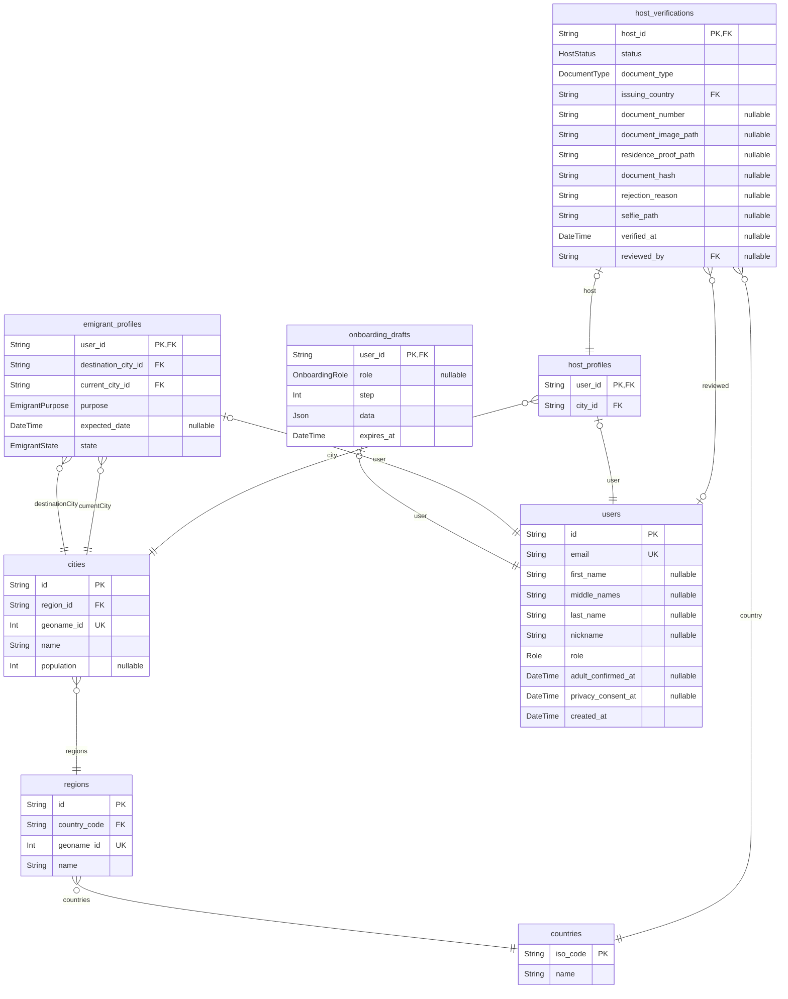

# Farol

> Generated by [`prisma-markdown`](https://github.com/samchon/prisma-markdown)

- [default](#default)

## default

### `countries`

Properties as follows:

- `iso_code`:
- `name`:

### `regions`

Properties as follows:

- `id`:
- `country_code`:
- `geoname_id`:
- `name`:

### `cities`

Properties as follows:

- `id`:
- `region_id`:
- `geoname_id`:
- `name`:
- `population`:

### `users`

Properties as follows:

- `id`:
- `email`:
- `first_name`:
- `middle_names`:
- `last_name`:
- `nickname`:
- `role`:
- `adult_confirmed_at`:
- `privacy_consent_at`:
- `created_at`:

### `onboarding_drafts`

Properties as follows:

- `user_id`:
- `role`:
- `step`:
- `data`:
- `expires_at`:

### `emigrant_profiles`

Properties as follows:

- `user_id`:
- `destination_city_id`:
- `current_city_id`:
- `purpose`:
- `expected_date`:
- `state`:

### `host_profiles`

Properties as follows:

- `user_id`:
- `city_id`:

### `host_verifications`

Properties as follows:

- `host_id`:
- `status`:
- `document_type`:
- `issuing_country`:
- `document_number`:
- `document_image_path`:
- `residence_proof_path`:
- `document_hash`:
- `rejection_reason`:
- `selfie_path`:
- `verified_at`:
- `reviewed_by`:
